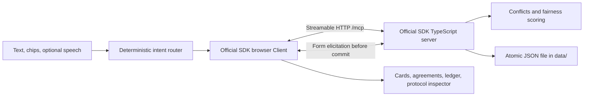

# RoomLilt

**A free slot is not always a fair slot.** RoomLilt helps a fictional household resolve competing needs without quietly asking the same person to give way every time.

Maya needs recovery sleep after a night shift. Sam's laundry must move to protect it. In the evening, Sam's game night and Leo's reading compete for the living room. The cheapest adjustment asks Sam to yield again; the fairness-aware recommendation asks Leo instead. RoomLilt shows that choice and asks each person making a change before saving an agreement.

This is a self-hosted Model Context Protocol (MCP) server with a real MCP browser client in a simulated Alexa+-style display. No accounts, API keys, cloud services, language models, or paid APIs are needed. All household data is fictional.

## Run locally

Use **Node.js 22.12 or newer within the Node 22 release line** and npm.

```sh
npm ci
npm run demo:reset
npm run dev
```

Open **http://127.0.0.1:5173**. The MCP server binds to **127.0.0.1:3001**; Vite forwards `/mcp` to it. Both start with `npm run dev`; Ctrl+C stops both. Run commands from this directory.

`npm run demo:reset` works with the server stopped or running. When running, it calls the real `reset_demo` tool so memory and disk stay consistent. Reset removes demo agreements and restores the fixed fictional day **October 19, 2026**, including the original two-week ledger history. Do not run multiple server processes against the same file.

The revised scenario uses storage schema 2. First-pass files are not silently converted: stop an old server and run `npm run demo:reset` to explicitly replace the old fictional scenario. That reset removes its agreements. Keep a copy of the old file first if you want to retain it.

```sh
npm run build    # Type-check server, client, scripts, and tests; build browser bundle
npm test         # Domain, intent-router, persistence, and real HTTP integration tests
```

For the built browser bundle, use two terminals:

```sh
npm start        # Terminal 1: local MCP server
npm run preview # Terminal 2: http://127.0.0.1:4173
```

The bundle contains the official SDK client. The server runs TypeScript through the locally installed `tsx`. Default ports are intentional: the proxy and Origin allowlist match them.

## Video and submission text

The [English demo video](https://www.youtube.com/watch?v=WNoZfZWvjL8) is 119.0 seconds at 1280×800 in H.264/AAC. It was recorded from real browser interactions with Playwright and assembled with ffmpeg. The voices are synthesized locally with Kokoro (Apache-2.0 model weights): `am_michael` narrates and `af_heart` speaks as the assistant. See [video/README.md](video/README.md) for the recording and assembly tooling. The recorder owns fresh fictional state and requires unused ports 3001 and 5173. The English Devpost field map is in [submission/SUBMISSION_FIELDS.md](submission/SUBMISSION_FIELDS.md); the story, feedback, and feature requests are also available as separate files in `submission/`.


## Demo script

Use suggested phrases or type. Microphone input is optional. Enable spoken responses with the speaker button; output uses browser `speechSynthesis` in English.

1. **“Alexa, what's clashing today?”** Two independent groups appear: Sam's loud 09:00–11:00 laundry conflicts with Maya's protected 08:00–14:00 sleep and Leo's quiet meeting; Sam's 19:00–21:00 game night competes with Leo's 19:00–20:00 reading for the living room and its TV.
2. **“Find a fair plan.”** Resolve the morning first. The recommended option moves laundry to 14:00–16:00. Maya's sleep stays fixed. This is labeled a **Required yield**; consent is still required, and it still counts toward fairness.
3. Choose **option 1**. A real `elicitation/create` form asks **Sam** for consent. Try **Decline** or **Cancel** first: schedule and ledger remain unchanged. Choose again and explicitly accept as Sam. His ledger becomes **9 yields: 7 required, 2 negotiated; 20 effort points**.
4. **“Who gets the living room tonight?”** Compare the **Lowest disruption** plan (Sam delays game night to 20:00–22:00, 1.5 effort points) with the recommended **Fairest** plan (Leo reads in the private study, 2 effort points). The explanation uses the actual history: Sam has yielded 9 times in 14 days, Leo once. Choose the recommended option and accept as **Leo**. Sam keeps game night at 19:00–21:00.
5. Expand **Protocol inspector**. Open the raw `initialize` response to see `"protocolVersion": "2025-11-25"`. Inspect `tools/list`, `tools/call`, and form elicitation. These are real SDK transport messages.
6. Stop and restart `npm run dev`. Reload or choose **Reconnect**, then ask **“What did we agree?”** Both agreements and the ledger reload from disk. A page refresh alone demonstrates a new client session; stopping the server demonstrates persistence across server restarts.
7. **“Leo's meeting runs 30 minutes late.”** The meeting now ends at 11:30 and conflicts with Sam's 11:00–12:00 online class. Compare Leo using the private study against Sam delaying class. The display names the **kept laundry and evening reading agreements**. Neither is changed by this report or its repair.
8. Choose the recommended repair and accept as **Leo**. Ask for clashes or **“Is it fair?”** to inspect the updated ledger.

Required yields protect declared sleep or health needs; negotiated yields resolve flexible choices. Both contribute equally to the fairness history. Fairness influences feasible choices and cannot override protected needs or consent. Optional leading **“Alexa”** and **“Hey Alexa”** work with supported phrases. One demonstrator can respond as Sam or Leo: these fictional roles demonstrate consent interaction, **not identity authentication**.

## Architecture and planning



The router translates a bounded set of English intents into tool calls. The SDK initializes, discovers tools, maintains a session, and carries tool results and consent. Cards render `structuredContent`; tools also return readable text.

The solver detects connected overlaps involving resources, member double-bookings, and noise versus quiet constraints. Each activity explicitly declares allowed `flexibleWindow`, `alternativeResourceIds`, `quietAlternative`, or `minDuration` options. The solver invents none of these permissions from an activity title, member identity, or room ID. It enumerates time moves on a 15-minute grid within declared windows, optional shortening at conflict boundaries, and declared room/mode changes. Feasible start-time swaps can emerge from those windows. It rejects constraint violations and unnecessary adjustments before scoring. Fixed protected needs cannot move.

**Effort points are bounded at 1–3 per changed activity:** 1 base point, plus up to 1 for the start-time shift (`absolute shift / 120 minutes`), up to 1 for shortening (`minutes removed / 30`), and 1 for a room or mode change, with the total capped at 3 and rounded to two decimals. A five-hour laundry delay therefore costs 2 points, not 300 minutes. A member's effort figure sums these points; it is an explanatory estimate, not measured time lost.

The **disruption score** sums the current changes' effort points. The **fairness score** adds **2 points per historical yield of each changing member**, counting each member's history once per plan. Lower is preferred. Required and negotiated history count equally. The recommendation minimizes the fairness score, and the menu also retains the lowest-disruption alternative even when it asks a different person to yield. Titles use the actual changes. Identical bounded scores favor the smaller actual timing change. At most three plans are returned; fewer are possible if declared alternatives cannot provide multiple feasible resolutions.

The primary ledger metric is **yields in the last 14 days**, with required/negotiated counts and effort shown separately. Initial history: Sam **8 yields (6 required, 2 negotiated), 18 effort points**; Leo **1 negotiated yield, 2 points**; Maya **2 yields (1 required, 1 negotiated), 4 points**. One accepted mediation adds one yield per changing member, even when several activities change. If any of that member's changes is required, that mediation's yield is classified as required. Each changed activity gets its own agreement record so a repair can retain unrelated agreements exactly. Superseded agreements retain their historical yielding.

Event reports save factual extensions/cancellations immediately. A directly changed activity's original agreement becomes historical rather than falsely presenting its old time as current; other activity agreements are preserved. Repairs remain proposals until all changing members consent. Revision checks reject stale plans, including when another session changes state during consent. Writes are serialized and revalidated immediately before saving. Any required refusal aborts the entire commit.

## MCP surface

Endpoint: **`http://127.0.0.1:3001/mcp`**. Stateful Streamable HTTP supports POST, GET event streams, and DELETE session termination. Sessions use `Mcp-Session-Id`; subsequent requests use `MCP-Protocol-Version: 2025-11-25`.

| Tool | Arguments | Result |
| --- | --- | --- |
| `get_household_state` | `{}` | Members, resources, activities, agreements. |
| `find_conflicts` | `{ "date": "2026-10-19" }` (optional date) | Connected conflicts on that date. |
| `propose_plans` | `{ "conflictId": "...", "date": "YYYY-MM-DD" }` | Feasible choices, concrete changes, ledger deltas. `date` is optional and defaults to the demo day. |
| `commit_plan` | `{ "planId": "..." }` | Consent from every changing member, then atomic commit. |
| `report_change` | `{ "activityId": "leo-meeting", "change": "extend", "minutes": 30 }` | Save change and return affected agreements/repairs. `change: "cancel"` removes the activity. Extensions use positive 15-minute increments, up to 180 per call. |
| `get_fairness_ledger` | `{}` | Last-14-days yields, required/negotiated counts, and effort points. |
| `reset_demo` | `{}` | Restore fictional scenario and historical ledger. |

JSON resources: **`household://state`**, **`household://ledger`**. Prompt: **`resolve-household-fairly`** guides discovery, comparison, consent, and selective repair.

The pinned **`@modelcontextprotocol/sdk` 1.32.1** negotiates protocol revisions. An initialize request for **2025-11-25** or an unsupported newer revision such as **2026-07-28** receives **2025-11-25**. Supported older revisions follow SDK behavior; the application does not reject them before negotiation. Subsequent request headers are validated by the SDK. Our browser client requests and displays **2025-11-25** and verifies that result. Runtime SDK calls are in `src/server/app.ts` and `src/client/mcp.ts`. Foreign Origin/Host requests are rejected. Allowed browser origins are HTTP localhost/127.0.0.1 on ports 3001, 5173, and 4173. Native clients can omit Origin. The server binds to 127.0.0.1.

References: official [Streamable HTTP specification](https://modelcontextprotocol.io/specification/2025-11-25/basic/transports) and [form elicitation specification](https://modelcontextprotocol.io/specification/2025-11-25/client/elicitation).

## Use it from an existing AI assistant

Start the server with `npm start`. Any MCP client that supports Streamable HTTP can use `http://127.0.0.1:3001/mcp`. For example, Claude Code registers an HTTP MCP server like this:

```sh
claude mcp add --transport http roomlilt http://127.0.0.1:3001/mcp
```

On October 19, 2026 we checked this path with Claude Code 2.1.303 in non-interactive mode, using a one-off `--mcp-config` file instead of a saved registration. It connected over Streamable HTTP, called `find_conflicts`, `get_fairness_ledger` and `propose_plans`, and reported that the Fairest evening plan asks Leo to yield. A second run against the final state of the recorded demo, with only project settings loaded, called `get_household_state` and `get_fairness_ledger`. That run was rendered as an optional video scene, which is not part of the submitted demo video. Connection setup and form support depend on the installed assistant version. A client without form elicitation can read and propose but cannot commit. The standalone Agent Skill at `skills/household-fairness/SKILL.md` explains the tool workflow; it does not install or configure an assistant automatically.

## Storage and verification

`data/household.json` is created locally and excluded by `.gitignore`. Writes use a unique temporary file followed by atomic rename in the same directory. Memory changes only after a successful write. Invalid existing JSON fails visibly rather than silently resetting. Atomic replacement prevents partial file contents; it is not distributed storage or a power-loss durability guarantee.

Tests use unique files under `data/tests/` and ephemeral loopback ports. They do not reset the interactive demo. Real HTTP tests verify protocol negotiation, discovery, resources/prompts, consent acceptance/refusal/cancellation, restart loading, selective repair, stale consent rejection, and transport protections. A DOM simulation test also executes the actual display and SDK client over real HTTP, exercising rendered card contents, consent controls, reconnect, and repair. This checks application logic, not browser layout or audio.

Download the test browser **inside this project**:

```sh
PLAYWRIGHT_BROWSERS_PATH=./data/browser-cache npx playwright install chromium
npm run test:browser
```

The browser smoke test uses separate demo data. On October 20, 2026, `npm run build` exited 0, `npm test` passed 65 tests in 6 files, and `npm run test:browser` passed 2 tests.

## Alexa+ track fit and limitations

- A self-hosted MCP 2025-11-25 server using Streamable HTTP, with the official SDK running on both server and client.
- Stateful coordination, explicit consent, persisted agreements, fairness history, and partial replanning.
- Simulated smart-display cards, conversation, speech, and raw protocol inspection. No Amazon preview tools, logos, device images, or wake-word audio. This is not an actual Alexa+ integration or certification.
- A deterministic English router and small fictional day, not open-ended language understanding or a general calendar optimizer. Speech input depends on browser/platform support and may use a vendor service. Text and chips remain available. Household MCP traffic stays local; microphone audio handling depends on the browser.
- The ledger is a fixed 14-day fictional snapshot ending on the demo date, plus agreements made for that day. It does not roll history forward or expire old entries over real calendar days. Effort coefficients are illustrative, not a validated measure of household fairness. Noise constraints conservatively apply across the whole home; room sound isolation is not modeled.
- One trusted local demo household. No authenticated member identities, accounts, authorization, multi-process coordination, or public-deployment hardening. Do not expose the service publicly.

## File map

`src/domain/`: canonical day, solver, JSON store. `src/server/`: MCP tools, resources, prompt, HTTP endpoint. `src/client/`: actual browser MCP client, router, display. `tests/`: automated checks. `skills/`: Agent Skill for the tool workflow. `scripts/` and `video/`: demo reset and video tooling. `submission/`: Devpost text. `FRICTION_LOG.md`: actual build friction.
